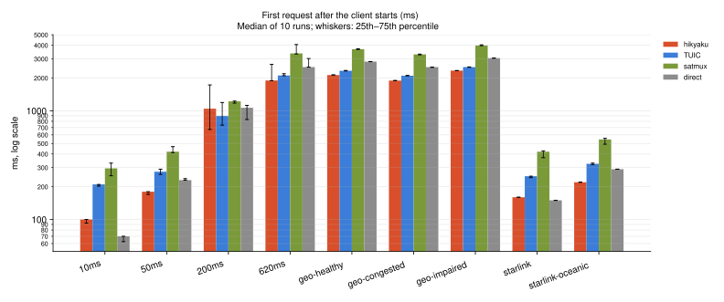
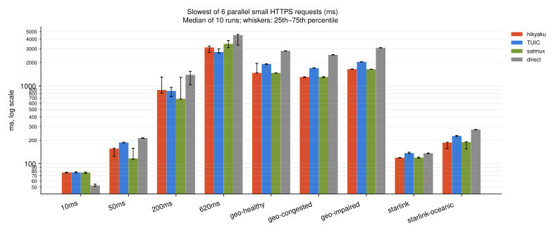
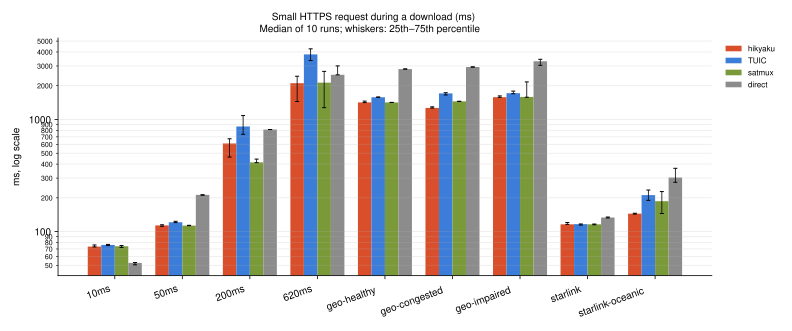
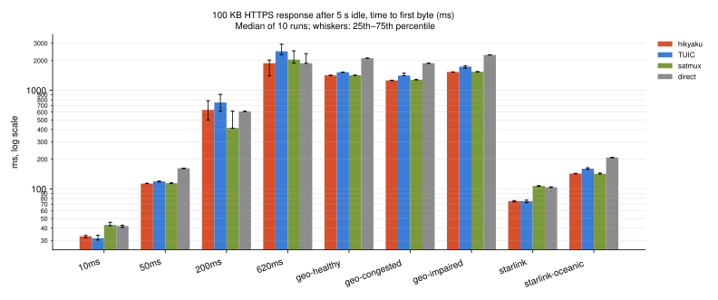
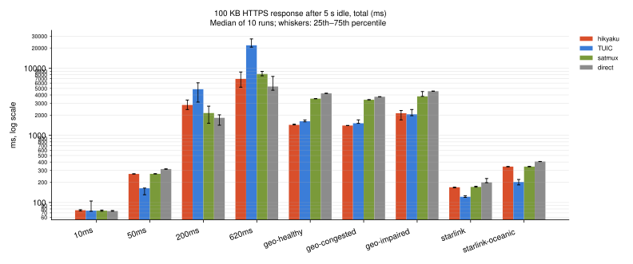
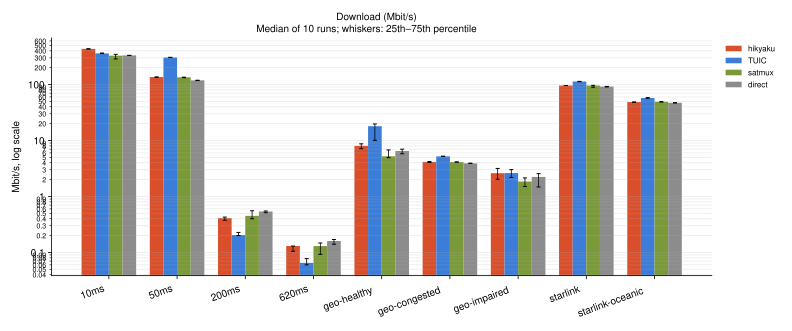

<h1 align="center">🏃‍♂️ hikyaku</h1>
<p align="center"><sup>(飛脚, ひきゃく, <em>courier</em> in Japanese)</sup></p>
<p align="center">A high-performance multiplexing proxy that stays lightning fast and highly reliable everywhere,<br />from fiber broadband to lossy in-flight Wi-Fi.</p>

- With **0-RTT**, every new connection saves a full round trip, especially noticeable on high-latency links like the 600 ms on satellite in-flight Wi-Fi.
- With **dynamic record sizing**, responses start arriving sooner, especially on lossy links, while large downloads still run at full speed.
- A **warm connection pool** has connections ready before you need them and reuses them across requests.
- Every request takes the fastest, least busy connection, powered by **latency-aware load balancing**.
- **Adaptive keepalives and healthchecks** keeps congestion windows open, continuously monitored for responsiveness and reliability, without consuming unnecessary resources.
- Connections stuck on a slow route or QoS throttling are replaced automatically by **slow-path escape**.
- During flapping connections, **transparent failover** moves TLS handshakes still in flight to a healthy one, so apps barely notice.
- **Outage tolerance** keeps open connections alive through outages under 30 seconds.
- **Graceful server restarts** give in-flight requests time to finish while new ones go to the new server.
- **Encrypted DNS support for server-side** because why not.
- **Smart and intelligent DNS** with progressive parallelization, concurrent dialing, aggressive versions of happy eyeball v2 with simultaneous racing, optimistic caching, and more.

> [!NOTE]
> hikyaku is designed for network acceleration and reliability improvements. Circumventing censorship was not, is not, and will never be, part of hikyaku's design goals.

# Protocol Specification

[PROTOCOL.md](PROTOCOL.md)

# Usage

## Install

### Homebrew

```sh
brew install sukkaw/tap/hikyaku
```

### GitHub Releases

Prebuilt binaries for macOS, Linux and Windows (x86-64 and ARM64) and FreeBSD (x86-64) are available on [GitHub Releases](https://github.com/SukkaW/hikyaku/releases/latest). Each archive contains both `hikyaku-server` and `hikyaku-client`.

### Go

Requires Go 1.27.3 or later.

```sh
go install github.com/SukkaW/hikyaku/cmd/hikyaku-server@latest
go install github.com/SukkaW/hikyaku/cmd/hikyaku-client@latest
```

## Server

Run the server on a host the client can reach over TCP. Any string works as the pre-shared key.

```sh
# minimal server example
hikyaku-server -psk 'your-psk'
# full configuration example
hikyaku-server -listen ':8444' -psk 'your-psk' -dns 'https://1.1.1.1/dns-query' -dns 'tls://8.8.8.8' -dns 'h3://1.0.0.1/dns-query'
```

| Flag      | Default             | Description                                                                                                                                                                                          |
| --------- | ------------------- | ---------------------------------------------------------------------------------------------------------------------------------------------------------------------------------------------------- |
| `-listen` | `:8444`             | Address to listen on for clients                                                                                                                                                                     |
| `-psk`    | (required)          | Pre-shared key; the client must use the same one                                                                                                                                                     |
| `-dns`    | the system resolver | DNS server for destinations; repeat it to use several. An IP, or a `udp://`, `tcp://`, `tls://`, `https://`, `quic://`, `h3://` or `sdns://` address. The server's hosts file is still checked first |

On Linux, the server uses BBR congestion control when the kernel has BBR and either the server runs as root, or `bbr` is the system default or listed in `net.ipv4.tcp_allowed_congestion_control`. Otherwise it logs a warning for each client connection and uses the system default.

## Client

The client exposes a local SOCKS5 proxy, supporting both TCP (`CONNECT`) and UDP (`UDP ASSOCIATE`).

```sh
# minimal client example
hikyaku-client -server 203.0.113.10:8444 -psk 'your-psk'
# full client example with custom listen port
hikyaku-client -listen 127.0.0.1:11080 -server 203.0.113.10:8444 -psk 'your-psk' -carriers 8

# test the SOCKS5 proxy through the client
curl --socks5-hostname 127.0.0.1:1080 https://example.com
```

| Flag        | Default          | Description                                                     |
| ----------- | ---------------- | --------------------------------------------------------------- |
| `-listen`   | `127.0.0.1:1080` | SOCKS5 listen address                                           |
| `-server`   | (required)       | Server address, `host:port`                                     |
| `-psk`      | (required)       | Pre-shared key, the same as the server's                        |
| `-carriers` | `4`              | Maximum number of active connections to the server (at least 1) |

## Surge for Mac

Installing the hikyaku client with [Homebrew](#homebrew) is recommended. Surge can then start hikyaku client as an [External Proxy Program](https://manual.nssurge.com/policies/external.html):

```ini
[Proxy]
hikyaku = external, exec = "/opt/homebrew/bin/hikyaku-client", args = "-listen", args = "127.0.0.1:11080", args = "-server", args = "203.0.113.10:8444", args = "-psk", args = "your-psk", local-port = 11080, addresses = 203.0.113.10, udp-relay = true
```

- `exec` is the full path to `hikyaku-client`. With Homebrew it is `/opt/homebrew/bin/hikyaku-client` on Apple silicon Macs (and `/usr/local/bin/hikyaku-client` on Intel Macs).
- `local-port` must match the port of the client's `-listen`.
- `addresses` takes the server's IP address, not a hostname.
- `udp-relay = true` allows hikyaku to relay Surge's UDP traffic as well.

# Benchmark

- hikyaku v0.1.0, [TUIC](https://github.com/Itsusinn/tuic) v2.0.0-dev10, [satmux](https://github.com/Th0rgal/satmux) `2922ebb`, and a direct connection without a proxy.
- Congestion control is cubic for all four, since the test kernel has no BBR; TUIC, which defaults to BBR, is set to cubic on both ends. hikyaku runs with `-carriers 4` and satmux with `--carriers 12`, their defaults.
- Links emulated with [`tools/netsim`](tools/netsim) on one Linux machine (6 vCPUs, kernel 6.18). Every request is a new `curl` process, through each proxy's SOCKS5 port or, for direct, straight to the test site.
- Medians of 10 runs.

| Profile            | Link                                                                                       |
| ------------------ | ------------------------------------------------------------------------------------------ |
| `10ms`             | 10 ms, 0% loss, 500 Mbit/s                                                                 |
| `50ms`             | 50 ms, 0% loss, 500 Mbit/s                                                                 |
| `200ms`            | 200 ms, 5% loss, 100 Mbit/s                                                                |
| `620ms`            | Harsh stress: 620 ms, 10% uniform loss, 5 Mbit/s                                           |
| `geo-healthy`      | Healthy GEO: 700 ms, 0.05% loss each way, 50/4 Mbit/s                                      |
| `geo-congested`    | Congested GEO: 620 ms, queue drops only, 5.9/3.9 Mbit/s                                    |
| `geo-impaired`     | Impaired GEO: 750 ms, 0.1% loss each way, ~10 s blackouts every ~90 s, 5/1 Mbit/s          |
| `starlink`         | Starlink continental: 30 ms, 0.02% loss each way, 125/15 Mbit/s, cabin spikes, 15 s pauses |
| `starlink-oceanic` | Starlink oceanic: 65 ms, 0.02% loss each way, ~1 s blackout every ~10 min, 65/24 Mbit/s    |

## First request after the client starts (ms)



| Profile            |  hikyaku |    TUIC | satmux |  direct |
| ------------------ | -------: | ------: | -----: | ------: |
| `10ms`             |      100 |     210 |    295 |  **70** |
| `50ms`             |  **180** |     275 |    420 |     230 |
| `200ms`            |     1045 | **895** |   1220 |    1065 |
| `620ms`            | **1900** |    2110 |   3370 |    2520 |
| `geo-healthy`      | **2130** |    2330 |   3685 |    2830 |
| `geo-congested`    | **1895** |    2100 |   3300 |    2520 |
| `geo-impaired`     | **2340** |    2520 |   3990 |    3050 |
| `starlink`         |      160 |     250 |    420 | **150** |
| `starlink-oceanic` |  **220** |     325 |    545 |     290 |

## Slowest of 6 parallel small HTTPS requests (ms)



| Profile            |  hikyaku |     TUIC |   satmux | direct |
| ------------------ | -------: | -------: | -------: | -----: |
| `10ms`             |       77 |       78 |       77 | **53** |
| `50ms`             |      156 |      187 |  **117** |    214 |
| `200ms`            |      886 |      863 |  **682** |   1389 |
| `620ms`            |     3131 | **2735** |     3478 |   4494 |
| `geo-healthy`      |     1474 |     1917 | **1471** |   2828 |
| `geo-congested`    | **1306** |     1698 |     1308 |   2514 |
| `geo-impaired`     |     1647 |     2041 | **1642** |   3098 |
| `starlink`         |  **120** |      137 |  **120** |    136 |
| `starlink-oceanic` |  **187** |      227 |      190 |    275 |

## Small HTTPS request during a download (ms)



| Profile            |  hikyaku | TUIC |   satmux | direct |
| ------------------ | -------: | ---: | -------: | -----: |
| `10ms`             |       74 |   76 |       74 | **53** |
| `50ms`             |      114 |  121 |  **113** |    213 |
| `200ms`            |      611 |  866 |  **414** |    814 |
| `620ms`            | **2106** | 3805 |     2130 |   2502 |
| `geo-healthy`      |     1419 | 1577 | **1418** |   2816 |
| `geo-congested`    | **1268** | 1707 |     1451 |   2939 |
| `geo-impaired`     | **1579** | 1715 |     1588 |   3304 |
| `starlink`         |  **116** |  117 |  **116** |    134 |
| `starlink-oceanic` |  **145** |  212 |      187 |    304 |

## 100 KB HTTPS response after 5 s idle, time to first byte (ms)



| Profile            |  hikyaku |   TUIC |  satmux | direct |
| ------------------ | -------: | -----: | ------: | -----: |
| `10ms`             |       33 | **32** |      43 |     42 |
| `50ms`             |  **113** |    119 |     114 |    162 |
| `200ms`            |      632 |    750 | **415** |    611 |
| `620ms`            | **1878** |   2484 |    2045 |   1880 |
| `geo-healthy`      | **1416** |   1523 |    1417 |   2115 |
| `geo-congested`    | **1259** |   1408 |    1279 |   1880 |
| `geo-impaired`     | **1532** |   1734 |    1541 |   2282 |
| `starlink`         |   **75** | **75** |     107 |    104 |
| `starlink-oceanic` |      143 |    160 | **142** |    208 |

## 100 KB HTTPS response after 5 s idle, total (ms)



| Profile            |  hikyaku |     TUIC | satmux |   direct |
| ------------------ | -------: | -------: | -----: | -------: |
| `10ms`             |       77 |       76 |     76 |   **75** |
| `50ms`             |      266 |  **163** |    267 |      315 |
| `200ms`            |     2835 |     4862 |   2147 | **1824** |
| `620ms`            |     6927 |    21942 |   8204 | **5336** |
| `geo-healthy`      | **1433** |     1620 |   3523 |     4220 |
| `geo-congested`    | **1401** |     1514 |   3389 |     3754 |
| `geo-impaired`     |     2133 | **2055** |   3810 |     4548 |
| `starlink`         |      169 |  **122** |    171 |      199 |
| `starlink-oceanic` |      342 |  **202** |    342 |      407 |

## Download (Mbit/s)



Median of 3 downloads per run, each sized to 8 s at the link's download cap, between 1 MB and 10 MB.

| Profile            | hikyaku |     TUIC | satmux |    direct |
| ------------------ | ------: | -------: | -----: | --------: |
| `10ms`             | **433** |      359 |    327 |       331 |
| `50ms`             |     136 |  **304** |    135 |       119 |
| `200ms`            |   0.410 |    0.205 |  0.450 | **0.540** |
| `620ms`            |   0.130 |   0.0650 |  0.130 | **0.160** |
| `geo-healthy`      |    8.02 | **18.0** |   5.23 |      6.49 |
| `geo-congested`    |    4.14 | **5.21** |   4.12 |      3.91 |
| `geo-impaired`     |    2.61 | **2.62** |   1.85 |      2.23 |
| `starlink`         |    95.8 |  **113** |   96.0 |      92.0 |
| `starlink-oceanic` |    48.6 | **57.3** |   49.1 |      47.1 |

## Failed requests

Out of 110 per system and profile: 10 first requests, 60 parallel requests, 30 requests during a download, 10 responses after idle.

| Profile            | hikyaku | TUIC | satmux | direct |
| ------------------ | ------: | ---: | -----: | -----: |
| `10ms`             |       0 |    0 |      0 |      0 |
| `50ms`             |       0 |    0 |      0 |      0 |
| `200ms`            |       0 |    0 |      0 |      0 |
| `620ms`            |       0 |    0 |      9 |      0 |
| `geo-healthy`      |       0 |    0 |      0 |      0 |
| `geo-congested`    |       0 |    0 |      0 |      0 |
| `geo-impaired`     |       0 |   11 |      2 |      1 |
| `starlink`         |       0 |    0 |      0 |      0 |
| `starlink-oceanic` |       0 |    0 |      0 |      0 |

# License

[MIT](LICENSE)

----

**hikyaku** © [Sukka](https://github.com/SukkaW), Authored and maintained by Sukka with help from contributors ([list](https://github.com/SukkaW/hikyaku/graphs/contributors)).

> [Personal Website](https://skk.moe) · [Blog](https://blog.skk.moe) · GitHub [@SukkaW](https://github.com/SukkaW) · Telegram Channel [@SukkaChannel](https://t.me/SukkaChannel) · Mastodon [@sukka@acg.mn](https://acg.mn/@sukka) · Twitter [@isukkaw](https://twitter.com/isukkaw) · BlueSky [@skk.moe](https://bsky.app/profile/skk.moe)

<p align="center">
  <a href="https://github.com/sponsors/SukkaW/">
    
  </a>
</p>
